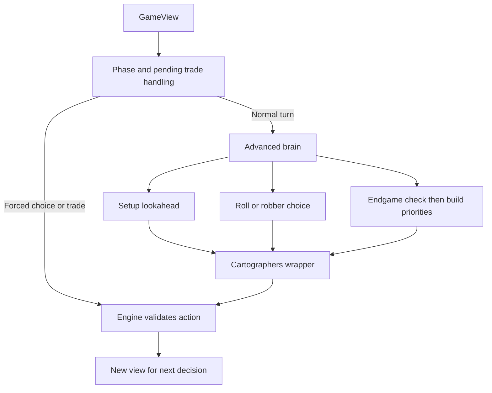

# How the Advanced bot decides

Reviewed 2026-11-16 against commit `4bcded4eb2e620943043cce785a4e9575d71770c`; build phase and
races updated 2026-11-17 for checkpoint `r1` (see [Plan-based build phase](#plan-based-build-phase-active-since-r1)).
This describes the repository version; it does not establish which version is deployed.
The [evidence review](EVIDENCE.md) separates observed behavior from demonstrated strength,
and the [improvement plan](PLAN.md) sets the conditions for further work.

Advanced uses a trained network to rank starting positions. During ordinary play it weighs
concrete build goals by estimated return per round of waiting (plans.ts), with hand-written
estimates of income, resource needs, rivals' likely targets, and opponent danger.
It rebuilds those estimates for each decision. It has no persistent strategic plan and does
not search future turns during normal play. A small, bounded endgame check is an exception.

## What is active

| Part            | Current behavior                                                                           | Source                                                                                               |
| --------------- | ------------------------------------------------------------------------------------------ | ---------------------------------------------------------------------------------------------------- |
| Parameters      | `KNOBS` defaults, overridden by `weights.json`; its source label is `r1`                   | [params.ts](../shared/bots/advanced/params.ts), [weights.json](../shared/bots/advanced/weights.json) |
| Setup           | Draft lookahead, 34 input features, a 16-unit hidden layer, and a separate lodestone bonus | [setup.ts](../shared/bots/advanced/setup.ts), [net.ts](../shared/bots/advanced/net.ts)               |
| Build phase     | Plan-based planner, `planner = 1` (since `r1`); the fixed order below is `planner = 0`     | [plans.ts](../shared/bots/advanced/plans.ts), [plan-turn.ts](../shared/bots/advanced/plan-turn.ts)   |
| Races for spots | Rival model, `raceModel = 1`: predicted rival targets and arrival times                    | [rivals.ts](../shared/bots/advanced/rivals.ts)                                                       |
| Strategies      | Training only: `strategy` knob presets for the strategy probe; 0 (shipped) changes nothing | [strategy.ts](../shared/bots/advanced/strategy.ts)                                                   |
| Value network   | Inactive: the shipped weights contain no `valueNet`                                        | [index.ts](../shared/bots/advanced/index.ts)                                                         |
| Cartographers   | Shared rules around the Advanced brain can replace its selected action                     | [cartographers.ts](../shared/bots/cartographers.ts)                                                  |

`r1` identifies weights (it is `s2` plus five knobs), not a complete version of the bot. Later code changes and newly
added default knobs affect behavior without changing that label. A saved checkpoint also
uses current code unless the evaluator explicitly loads an older reference.

## What it knows

The entry point receives only `GameView`: its own hand and development cards, the visible
board and pieces, legal actions, public scores and card counts, settings, trade offers,
and public history. It receives bank counts only when the room reveals them.
It cannot read opponents' actual hands, the deck order, or unrevealed fog contents.

Bot views also contain `likelyHands`, the engine's count inferred from observable events.
Unknown steals and survey finds introduce uncertainty; these estimates are not guaranteed
hands. When absent, the bot estimates hands from public card counts and production.
See [view.ts](../shared/engine/view.ts), [hands.ts](../shared/engine/hands.ts), and
`Economy.handOf` in [economy.ts](../shared/bots/advanced/economy.ts).

## Which decision runs first

The shared `actWith` wrapper in [bots/index.ts](../shared/bots/index.ts) runs before and
after the Advanced brain. Its order matters:
1. Discard, gold/split choices, special build, and eruption each have their own branch.
2. During the build phase, answer the first unanswered incoming trade. Offers involving
   discoveries, or requesting reserved lodestone, are declined before Advanced evaluates them.
3. Otherwise, review the bot's own outstanding offer.
4. Otherwise, ask the Advanced brain for a normal turn action.
5. Pass that result through the Cartographers wrapper, which may replace it.

The engine validates each proposed action. The normal bot driver tries Beginner after a
`GameError`, then a bank-aware forced gold choice, and can end the turn. It also caps actions
within a turn. Thus a completed game can contain fallback actions that Advanced did not
choose. Training records these as `fallback`. See [time.ts](../shared/engine/time.ts) and
[sim.ts](sim.ts). Timeout handling has additional limits and is not ordinary strategic play.

## Starting settlements and routes

For each starting settlement, the bot:
1. Ranks legal corners cheaply using resource odds, scarcity, variety, harbors, and nearby
   gold or island rewards. It keeps a small shortlist.
2. Evaluates the best eight candidates by playing out the remaining setup draft.
   Opponents choose greedily among up to twelve open corners; the bot considers three
   candidates at its own later picks.
3. Scores the resulting position with the setup network. Inputs summarize classic resource
   income, number diversity, harbors, expansion opportunities, opponents, and room settings.
4. Adds `setupLodestone * min(lodestonePips, 8)` on Cartographers maps, outside the network.

The network score is a ranking estimate learned from simulated outcomes, not a calibrated
probability of beating a person. It has no dedicated lodestone-income or charting-plan input;
some reach summaries can include lodestone value. The added lodestone term values immediate
income, without simulating investment in charts and splits.

The starting road or ship heads toward the best estimated open corner, discounting its value
by distance and rival proximity. This uses geometric distances, not a simulation of rivals'
hands, road construction, or blocking moves. Production forecasts and opponent draft choices
are approximations. Shortlisting also means some legal starts never receive network evaluation.

## How resources and goals are valued

`Economy` gathers production, routes, reachable empty settlement corners, an expansion target,
and a possible survey route. Its normal goals are a city, a settlement with any required
routes, a development card, and a survey ship when one can be reached.

Each goal receives:

`goal score = goal value / (1 + estimated rounds to afford it)`

City and settlement values include production estimates and an endgame multiplier.
Settlement values also include island or route rewards. Development uses a fixed knob value;
survey uses a fixed value with the endgame multiplier. The highest score is the saving goal;
it does not override every earlier build priority.

The affordability estimate divides each missing resource by expected production per round,
uses the slowest resource, distributes gold income among missing resources, and discounts
the wait for bank-tradable surplus already in hand. It floors income at 0.08 cards per round
and caps the estimate at 30 rounds. An immediately affordable bank exchange is assigned 0.5
rounds. Future surplus trading, dice variance, future investments, and opponent responses
are not simulated.

Hand value is the best goal score plus `secondGoal` times the next best, plus 0.02 per card,
minus 0.06 per card above the discard limit. Gold, discards, trades, and Year of Plenty use
this common estimate. It is a heuristic utility, not expected victory points or win probability.

The expansion target is the highest-value reachable open corner after a distance discount
and a penalty if rivals are as close or closer. Own paths use the road/ship path finder;
rival distance uses geometric distance from their buildings and route ends. No explicit
estimate asks when a rival can pay for a settlement or what a blocking road would deny them.

## Plan-based build phase (active since r1)

[plans.ts](../shared/bots/advanced/plans.ts) lists concrete goals each decision: a city on each
own settlement, a settlement on each reached corner, a route plus settlement to each reachable
open corner, a development card, a Longest Road push, and (Cartographers) a survey ship. Each
goal's payoff is in points: its points now plus its extra production over the rounds the game
probably has left (`roundsPerPoint` per point the leader still needs), cards valued at
`pointPerCard`. Goals are ranked by payoff / (1 + rounds to afford), and
[plan-turn.ts](../shared/bots/advanced/plan-turn.ts) takes the best goal's next step, trades
toward it, or spends on another goal only when that doesn't delay the best.

Added for `r1` (2026-11-17, [ANALYSIS.md](ANALYSIS.md)):
- **Races:** a settlement or route goal is multiplied by the chance we get there first, from
  [rivals.ts](../shared/bots/advanced/rivals.ts): each player's likely next targets (scored the
  way we score ours, preferring corners they already reach) and rounds to arrive (cards needed
  at their income, turn order). It predicts bots' next settlements 85–88% top 1.
- **What a settlement makes possible:** `cityOption` (0.4) of a later city there, and
  `frontierOption` (0.4) of the best open spot two or three pieces beyond it that our routes
  don't already approach.
- **Fog exploring off** (`exploreValue` 0): its payoff counted a new spot at every fog corner
  and overbuilt ships on Middle Fog. Needs a redesign before it returns.
- **Survey ship goal:** payoff 1 + 0.3 × `surveyValue`; the plan sails out, and the
  Cartographers step builds the ship.

Commitment comes only from progress: a half-built route is cheaper to finish, so it ranks
higher. There is no stored plan between decisions.

## Fixed build priorities (planner 0)

Before ordinary building, `winningMove` looks for a purchase sequence that wins this turn.
If it finds none, [turn.ts](../shared/bots/advanced/turn.ts) uses the following order, returning
the first available action and starting again from a fresh view after that action:

| Order | Decision                                                                                                                  |
| ----- | ------------------------------------------------------------------------------------------------------------------------- |
| 1     | Play a useful development card, using the rules below.                                                                    |
| 2     | Build the legal city with the best resource-weighted production.                                                          |
| 3     | Build the legal settlement with the best spot value.                                                                      |
| 4     | Extend Longest Road when its gap passes the configured reach limit and a legal piece increases length.                    |
| 5     | If saving for a survey ship, build the first ship toward open sea.                                                        |
| 6     | If saving for a settlement and no empty corner is already connected, build toward the expansion target.                   |
| 7     | Make a bank/harbor exchange when surplus can cover the saving goal's entire shortfall.                                    |
| 8     | Offer a player trade toward that goal, subject to offer limits.                                                           |
| 9     | Buy a development card if it is the goal or its spare-card value compensates for the reduction in hand value.             |
| 10    | Build a spare route toward a sufficiently close target, if no empty corner is already connected and enough pieces remain. |
| 11    | End the turn.                                                                                                             |

An affordable city therefore normally precedes an affordable settlement, a settlement race,
and a survey route, regardless of their relative goal scores. An earlier action can spend
cards the saving goal needs. The stored `spareDevelopment` value is 5, the top of its tuning
range, so late-priority card purchases can be permissive.

There is no saved commitment to a target between decisions. Re-evaluation allows adaptation,
but there is no explicit test that changing targets wastes earlier investments.

## Development cards and immediate wins

- **Knight:** play before rolling or building when it frees enough own production or takes
  Largest Army now. Holding knights to build the army over several future turns is not an
  explicit plan.
- **Year of Plenty:** maximize hand value over two-card choices, then play if those cards
  make a goal affordable. The immediate-win check can also request it.
- **Monopoly:** maximize likely cards held by rivals, weighted by own resource scarcity and
  the current goal. Play when the chosen resource is estimated to yield at least three cards.
- **Road Building:** play when two route pieces remain, a settlement piece remains, legal
  links exist, and an expansion target requires routes. Free routes follow that target;
  otherwise they use the first legal link, or finish the free-road phase.

The endgame check in [endgame.ts](../shared/bots/advanced/endgame.ts) combines up to four
scoring items: cities, settlements within two new links, an already reachable survey ship,
and a one-piece Longest Road capture. It includes bank/harbor trades and Year of Plenty,
permits at most one settlement plan requiring routes, and rechecks after each action.
It skips a required route goal that is not yet complete. It does not enumerate all legal
winning sequences, future turns, development-card draws, or negotiated player trades.

## Required route finish

On maps that require building in the route's finish area to win (Roadrace), the shared wrapper hides
every other settlement spot once a bot is down to its last settlement piece (`keepRoutePiece` in
[analysis.ts](../shared/bots/analysis.ts)), for every bot level. Advanced also makes the best reachable
finish corner its expansion target until it has built there, and skips Longest Road moves meanwhile.
It does not yet budget ships or roads for the route, so it can still run out of ships under the
`routeLinks: settlement` variation.

## Cartographers spending

The shared wrapper can supersede even a move selected by the immediate-win check:
1. Fit out an affordable survey ship first. Use the first legal survey edge and choose the
   best tied town by chart benefit.
2. Reserve lodestone for an immediately usable survey/relay, or for Advanced's reachable
   survey route. Advanced searches up to four new ships and reserves the survey cost whenever
   such a route exists, even when survey is not its highest-scoring goal.
3. Spend surplus lodestone on a split first, then a chart.
4. On ending the turn, try a productive relay or an exchange completing a survey/relay.
   A planned action giving away reserved lodestone can also be replaced by this step or a pass.

Charts use the extra production dots multiplied by own tile share minus weighted rival
share, including an estimate of future rival settlements/cities. The minimum gain is two
dots. This can reject an individual one-dot step toward a later, stronger tile.
Splits target a productive tile and a resource with low estimated income; Advanced may bank
trade for the card needed to add a resource it earns none of. Relay selection requires at
least five dots and avoids edges with a currently settleable endpoint.

These choices use [charting.ts](../shared/bots/charting.ts), whose chart scores count all
tile numbers. This differs from the main planner's income calculation. Survey routes choose
the shortest qualifying route, without comparing the eventual chart benefit of every route.

## Trades and opponents

Advanced values an incoming trade by its change in own hand value, minus an estimated
partner benefit multiplied by the partner's threat. Partner benefit is
`0.12 * max(0, cards given - cards received + 1)`; it does not evaluate the partner's actual
build opportunities. Near-winning partners are excluded by public score and `couldWinNext`.

If the offer is insufficient, the bot may counter for a missing goal resource. Repeated
counters to the same person are limited. Outgoing offers exchange surplus beyond the saving
goal for its missing resources, and target players whose estimated hands can supply them.
At human tables there is at most one outgoing offer per turn; people receive fair offers
only for a goal's final missing card, no more often than every third round. All-bot tables
permit up to three. Existing accepted offers are confirmed with the least threatening taker;
counter-offers are compared by trade gain. See [trade.ts](../shared/bots/advanced/trade.ts).

Threat rises with public points, development-card count, and leading among opponents.
`couldWinNext` adds a rough near-win test using likely hands plus two flexible cards,
reachable settlements, cities, and Longest Road. It is not a complete opponent planner.

Robber destinations maximize blocked production and useful steals, weighted by threat,
minus own harm. Pirate destinations use adjacent ships instead of production. Theft targets
favor useful cards held by dangerous opponents. Land blocking and knight relief count only
the base number, missing extra charted numbers. See [robber.ts](../shared/bots/advanced/robber.ts).

## Gold, discards, and special build

- Free gold choices enumerate resource bags for up to four cards. An own-turn immediate win
  takes priority, then hand value; additional owed cards are picked greedily.
- Split choices run first in the shared wrapper and prefer the permitted resource held in
  the smallest quantity. If all choices are splits, Advanced's gold evaluation is bypassed.
- `winningGold` only checks the active player's impending build phase. Off-turn choices
  receive no explicit next-turn winning-plan search.
- Discards remove the card that hurts hand value least, one at a time. If discoveries count
  toward the limit, the wrapper discards them only after resource cards run out.
- Special build takes a city, settlement, or survey first, then the normal build planner
  with offers disabled. Only roads, ships, surveys, cities, settlements, and card purchases
  returned by that planner survive its action filter; otherwise it passes. It does not
  compare every affordable special-build option independently.

## Confirmed gaps and their evidential limits

The following are established by control flow or arithmetic. None establishes a win-rate
improvement from changing it. In particular, an approximation can coexist with compensating
heuristics; correcting one input can change many decisions in either direction.

| ID  | Confirmed behavior or limitation                                                                                                                                                  | Consequence that can be established now                                                                                                                                      |
| --- | --------------------------------------------------------------------------------------------------------------------------------------------------------------------------------- | ---------------------------------------------------------------------------------------------------------------------------------------------------------------------------- |
| C1  | Fixed 2026-11-16: income, spot pips, city gains, and robber scoring now count charted numbers (`hexPips`), split tiles (half each resource), and relay stations (`productionOf`). | Matches engine payouts (tests in `cartographers-bots.test.ts`). Measured win change vs the old bot: +0.5 ±1.0 pp (Cartographers), +1.4 ±0.7 pp (5–6p): no demonstrated gain. |
| C2  | Fixed 2026-11-16: the survey route is found before the expansion target, so lodestone counts in the first ranking.                                                                | Measured together with C1 above.                                                                                                                                             |
| C3  | Cartographers runs after the Advanced brain.                                                                                                                                      | Its survey/split/chart action can replace `winningMove`; there is no final win-priority check. Actual missed-win frequency is unmeasured.                                    |
| C4  | Opponent trade gain uses card counts; expansion races use geometric proximity.                                                                                                    | Neither models an opponent's resource-enabled settlement race or economic investment.                                                                                        |
| C5  | City-first spending, survey reserves, and the two-dot chart cutoff are separate priorities.                                                                                       | They do not directly compare a sequence of economic investments against immediate points.                                                                                    |
| C6  | Split choices favor low hand counts; own-turn winning gold does not cover off-turn choices.                                                                                       | Several related resource-choice paths optimize different objectives.                                                                                                         |
| C7  | `choices()` filters available resource kinds but does not limit every enumerated count to known stock.                                                                            | A high-valued bag can be rejected by the engine and replaced by fallback play. Frequency is unmeasured.                                                                      |

For C1, the authoritative payout behavior is [production.ts](../shared/engine/production.ts)
with `hexNumbers` in [rules.ts](../shared/rules.ts). Splits give a choice between two resources,
not both resources; relays continue earning under the robber. Any future economic model
must preserve those distinctions rather than simply adding all possible payouts together.

## What existing tests establish

[advanced-bot.test.ts](../tests/advanced-bot.test.ts) covers selected robber/pirate decisions
and human trade limits. [cartographers-bots.test.ts](../tests/cartographers-bots.test.ts)
covers survey use and selected split/chart decisions. [endgame.test.ts](../tests/endgame.test.ts)
checks selected scoring sequences. [search.test.ts](../tests/search.test.ts) checks hidden-state
resampling. These are behavior checks, not statistical proof of higher win rates.

[bots.test.ts](../tests/bots.test.ts) checks completion and local decision timing: median
under 3 ms and maximum under 40 ms in its sampled positions. Those local limits are not a
measurement of total Worker request CPU. Any future change must also keep engine/projection
work and multiple decisions per request within deployment limits.
